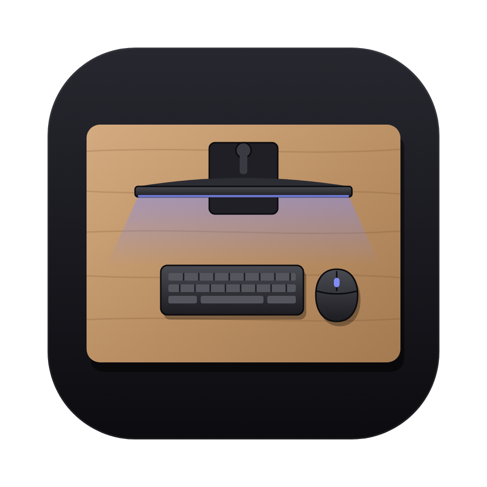
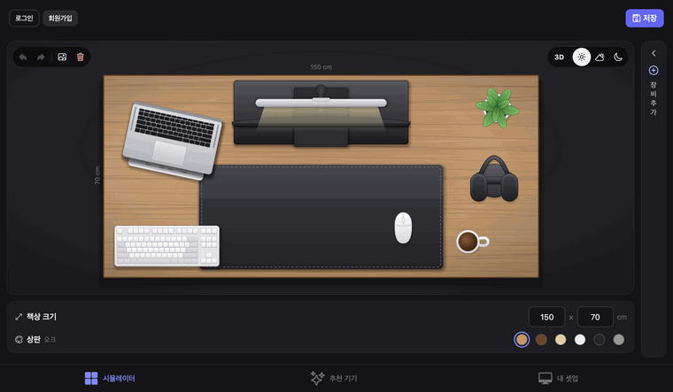
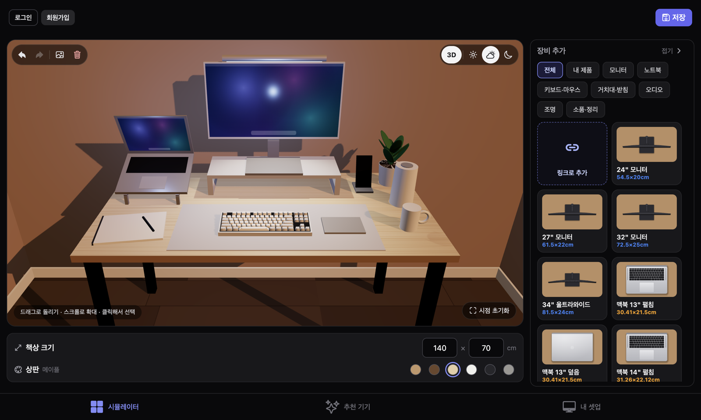
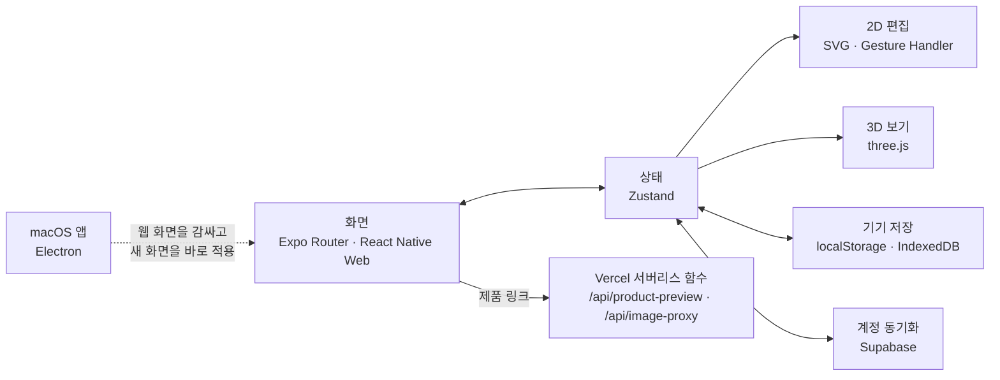

<div align="center">



# DeskBoard

데스크보드 · 실제 치수 기반의 데스크 셋업 시뮬레이터

<a href="https://deskboard-one.vercel.app"></a>&nbsp;&nbsp;<a href="https://github.com/dgim9390/DeskBoard/releases/latest"></a>

[](https://github.com/dgim9390/DeskBoard/releases/latest) _|_Web-27272A?style=flat-square)



</div>

## 소개

DeskBoard(데스크보드)는 책상과 장비를 실제 크기(cm)로 배치해, 사기 전에 데스크 셋업을 미리 꾸며 보는 앱입니다.
위에서 내려다보는 2D 화면에서 배치하고, 3D 화면으로 돌려 보며 실제 모습을 확인할 수 있습니다.
macOS 앱과 웹에서 똑같이 동작하며, 로그인하면 저장한 셋업이 기기 사이에 동기화됩니다.

모니터 암을 달면 책상 뒤 공간이 남을지, 새로 살 키보드가 데스크 매트에 맞을지처럼 사기 전에 궁금한 것들은 사진만 봐서는 알기 어렵습니다.
DeskBoard는 이런 고민을 실제 치수로 미리 확인해 보기 위해 만들었습니다.



## 핵심 기능

- **실제 치수로 배치**\
  책상과 장비 크기를 cm로 입력하고 실제 비율대로 배치합니다. 이동, 회전, 복제, 앞뒤 순서, 가운데 맞춤 가이드를 지원합니다.

- **2D와 3D 보기**\
  한 번의 클릭으로 3D로 전환해 회전하고 확대해 봅니다. 트랙패드 핀치로 가리키는 곳을 확대할 수 있고, 낮 · 저녁 · 밤 조명과 상판 재질 6종을 고를 수 있습니다.

- **링크로 실제 제품 추가**\
  제품 페이지 링크를 넣으면 이름, 대표 사진, 크기(가로 × 깊이 × 높이)를 자동으로 가져옵니다. 사진 배경은 자동으로 지워지고, 3D에서는 제품 종류에 맞는 모형으로 표시됩니다.

- **60여 종의 장비**\
  모니터, 노트북, 키보드, 마우스부터 모니터 암, 받침대, 헤드폰 거치대, 조명, 소품까지 데스크 셋업에 쓰는 장비를 바로 꺼내 쓸 수 있습니다. 모니터 암이나 받침대는 장비와 결합됩니다.

- **셋업 저장과 이미지 내보내기**\
  셋업을 계정에 저장해 macOS 앱, 웹, 다른 기기에서 이어서 작업합니다. 2D나 3D 화면을 PNG 이미지로 저장할 수 있습니다.

- **템플릿과 추천**\
  완성된 셋업 템플릿으로 바로 시작하거나, 현재 책상 구성에 맞춘 추천 제품을 확인합니다.

## 시작하기

### 웹 (권장)

설치 없이 [deskboard-one.vercel.app](https://deskboard-one.vercel.app)에서 바로 사용할 수 있습니다. 처음이라면 웹으로 시작하는 것을 권장합니다.

### macOS 앱

웹과 기능은 같고, 독립된 앱 창과 메뉴 막대에서 쓰고 싶을 때 설치합니다. Apple Silicon(M1 이후) 맥에서 사용할 수 있습니다.

1. [최신 릴리스](https://github.com/dgim9390/DeskBoard/releases/latest) 페이지의 **Assets**에서 `DeskBoard-x.x.x-arm64.dmg`를 내려받습니다.
2. 내려받은 `.dmg` 파일을 열고, **DeskBoard**를 **Applications** 폴더로 드래그합니다.
3. 응용 프로그램 폴더에서 **DeskBoard**를 실행합니다. 처음 실행할 때 보안 경고가 나오면 아래 [앱이 열리지 않는 경우](#앱이-열리지-않는-경우)를 따라 주세요.

## 앱이 열리지 않는 경우

DeskBoard는 Apple 공증을 받지 않은 개인 배포 앱이라, 처음 실행할 때 macOS 보안 경고가 나타납니다. 아래 순서대로 한 번만 허용하면 이후에는 바로 열립니다.

1. 경고 창에서 **완료**를 누릅니다. **휴지통으로 이동**은 누르지 않습니다.
2. **시스템 설정 → 개인정보 보호 및 보안**으로 이동합니다.
3. 화면 맨 아래로 내려 **그래도 열기**를 누릅니다.
4. 비밀번호를 입력하고 **열기**를 누릅니다.

**"손상되었기 때문에 열 수 없습니다"** 라는 메시지가 나오고 **그래도 열기**가 보이지 않으면, 터미널에서 아래 명령을 실행한 뒤 다시 엽니다.

```bash
xattr -dr com.apple.quarantine /Applications/DeskBoard.app
```

## 업데이트

- **화면 업데이트**: 앱을 켤 때 알림이 뜨면 **지금 적용**을 누릅니다. 메뉴 막대의 **DeskBoard → 업데이트 확인…** 으로 직접 확인할 수도 있습니다.
- **앱 업데이트**: 새 버전의 `.dmg`를 내려받아 Applications 폴더로 드래그하고 **대치**를 누릅니다. 기존 앱을 지울 필요는 없습니다.
- 저장한 셋업, 로그인, 내 제품은 업데이트 후에도 그대로 유지됩니다.

## 사용 팁

### 링크로 제품 추가하기

- 제조사 공식 홈페이지의 제품 상세 페이지 링크가 가장 정확합니다. (예: Apple, Logitech, Keychron, Xbox)
- 쿠팡, 네이버 스마트스토어처럼 자동 수집을 막는 쇼핑몰 링크는 지원하지 않습니다. 이때는 이름과 크기를 직접 입력하고, 상품 사진을 저장해 **사진 올리기**로 등록합니다.
- 높이는 3D 보기에 쓰입니다. 비워 두면 제품 종류에 맞게 자동으로 정해집니다.

### 단축키

- `⌘Z` 실행 취소 · `⌘⇧Z` 다시 실행
- `⌘D` 선택한 장비 복제 · `⌫` 선택한 장비 삭제
- `←` `↑` `→` `↓` 1cm 이동 (`⇧`와 함께 누르면 5cm)
- `⌘S` 셋업 저장 · `esc` 선택 해제

## 개발


### 구조



- **상태 관리**: 책상, 장비, 저장한 셋업을 하나의 Zustand 스토어가 관리합니다. 2D 편집 화면과 3D 보기가 같은 상태를 바라보므로 어느 쪽에서 옮겨도 바로 맞춰지고, 모든 편집은 실행 취소 기록에 남습니다.
- **제품 링크 분석**: Vercel 서버리스 함수가 제품 페이지를 받아 JSON-LD(Product)와 메타 태그(og 등)에서 이름, 사진, 가격을 읽고, 본문의 치수 표기를 찾아 가로 · 깊이 · 높이로 맞춥니다. 크롤링 라이브러리 없이 자체 해석기(`lib/productParse.js`)를 쓰며, 내부망 주소로의 요청은 막습니다(SSRF 방지).
- **배경 제거**: 서버 없이 브라우저의 canvas에서 처리합니다. 사진 테두리에서 시작해 배경색을 따라 지우고(flood fill), 옅은 그림자와 제품 사이에 갇힌 배경까지 정리합니다. 사진은 IndexedDB에 한 번만 보관합니다.
- **3D 보기**: 제품 종류별 모형을 코드로 만들어 실제 크기에 맞추고, 화면이 바뀔 때만 다시 그립니다. 3D 코드는 처음 3D를 켤 때만 불러옵니다.
- **macOS 앱**: Electron이 같은 웹 화면을 감쌉니다. 새 화면이 배포되면 앱을 다시 설치하지 않아도 알림에서 바로 적용할 수 있습니다.

### 실행

```bash
npm install
npx expo start                 # w: 웹, i: iOS 시뮬레이터
```

macOS 앱 빌드:

```bash
cd desktop
npm install
npm run dist                   # desktop/release/*.dmg 생성
```

- `.env.example`을 복사해 `.env`를 만들고 Supabase 프로젝트 URL과 공개 키를 입력합니다.
- 데이터베이스 스키마는 `supabase/schema.sql`에 있습니다.
- 폴더: `app/` 화면 · `components/` UI · `store/` 상태와 저장 · `lib/desk3d/` 3D 장면과 모형 · `api/` 제품 페이지 분석 · `desktop/` macOS 앱
